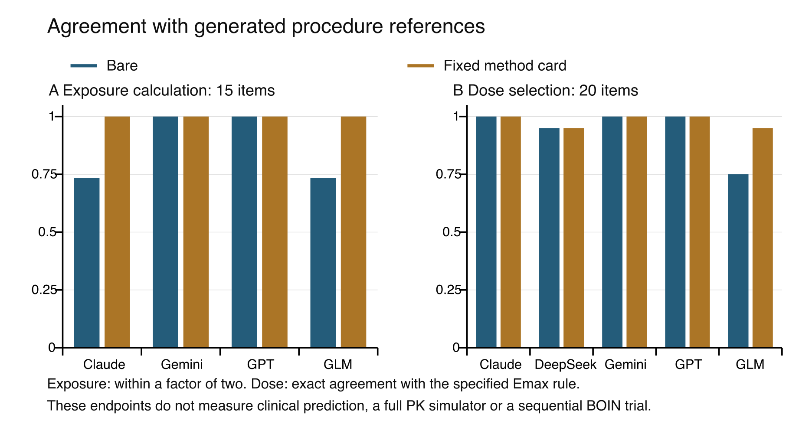

# RealDrug per-model paired results

| Model | Exposure bare | Exposure card | Dose bare | Dose card |
|---|---:|---:|---:|---:|
| Claude Opus 5.5 | 0.733 | 1.000 | 1.00 | 1.00 |
| DeepSeek V4-pro | — | — | 0.95 | 0.95 |
| Gemini 3.8 Flash | 1.000 | 1.000 | 1.00 | 1.00 |
| GPT-6.1-sol-pro | 1.000 | 1.000 | 1.00 | 1.00 |
| GLM-5.3-prime | 0.733 | 1.000 | 0.75 | 0.95 |

A dash means the matched cell is unavailable, not a zero score. These endpoint labels identify archived runs; they are not a claim that every provider's latest release was evaluated.

