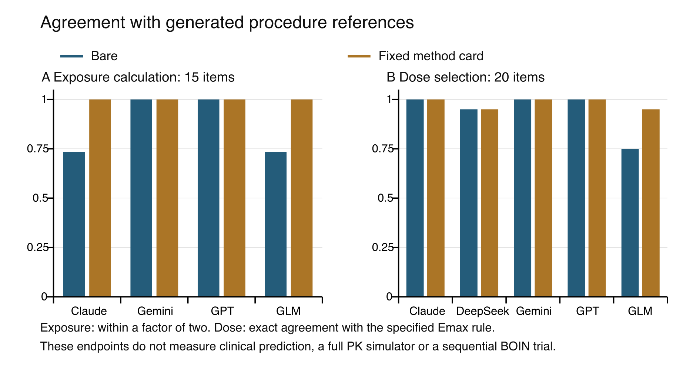

# RealDrug: condition comparisons

This file supersedes the historical product-ranking board. Values summarize fixed endpoint panels; item counts and model counts differ across rows. No overall rank or composite score is calculated. Values are displayed at manuscript precision. Full-precision per-file outputs and reference sets are in `reproduction/`.

## Completed paired comparisons

| Task | Items | Models | Bare | Method card | Difference [95% interval] |
|---|---:|---:|---:|---:|---|
| Exposure calculation: within twofold | 15 | 4 | 0.867 | 1.000 | +0.133 [0.067, 0.217] |
| Emax-rule dose selection: exact agreement | 20 | 5 | 0.940 | 0.980 | +0.040 [−0.020, 0.100] |

These serving-matched comparisons use the same retained endpoint labels, items, 8,000-token output budget and retry handling within each task. Intervals are paired item-bootstrap intervals (10,000 resamples; seed 20261118), conditional on the retained snapshots. The dose interval includes no improvement. The exposure change is carried by Claude and GLM; GPT and Gemini already reach the score ceiling without the card. No overall score pools the two endpoints.

| Model | Exposure bare | Exposure card | Dose bare | Dose card |
|---|---:|---:|---:|---:|
| Claude Opus 5.5 | 0.733 | 1.000 | 1.00 | 1.00 |
| DeepSeek V4-pro | — | — | 0.95 | 0.95 |
| Gemini 3.8 Flash | 1.000 | 1.000 | 1.00 | 1.00 |
| GPT-6.1-sol-pro | 1.000 | 1.000 | 1.00 | 1.00 |
| GLM-5.3-prime | 0.733 | 1.000 | 0.75 | 0.95 |

A dash means the matched cell is unavailable, not a zero score. These endpoint labels identify archived runs; they are not a claim that every provider's latest release was evaluated.

